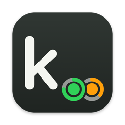
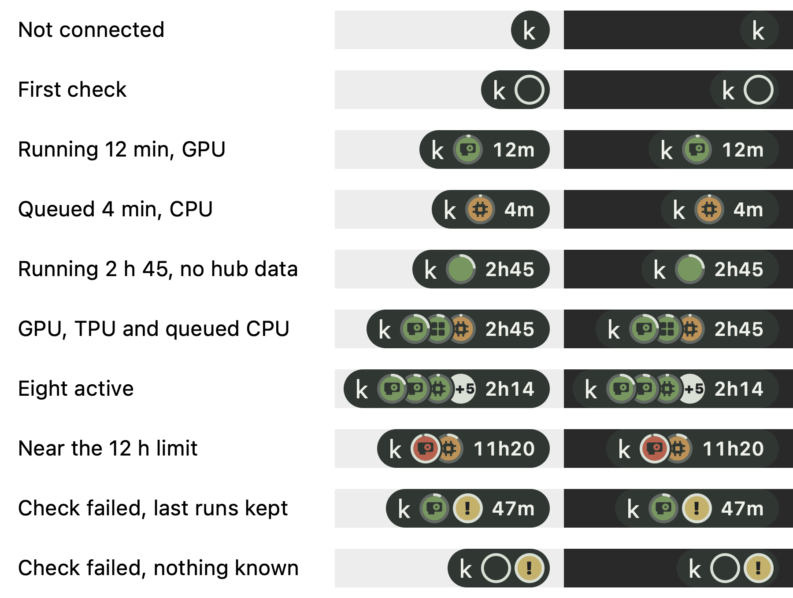

# KaggleMenuBar

A macOS menu bar app that shows which of your Kaggle notebooks are queued or running, and for how long, without opening the Kaggle website.

It reads status through Kaggle's official command line client. The app never sees or stores your Kaggle credentials, never submits, edits or deletes notebooks, and makes no Kaggle calls until you choose **Connect Kaggle**.

## Reading the menu bar



*Drawn by the app's own rendering code (`swift test` writes this image when `PILL_GALLERY` is set).*

Each active notebook is a circle on a graphite capsule, beside Kaggle's k:

- **Color is status.** Sage is running, amber is queued. A running notebook turns brick red from 11 hours, an hour before Kaggle stops a 12-hour session.
- **The ring is a 12-hour dial.** Its pale arc fills clockwise from 12 o'clock with the time the notebook has been going, so a full ring is Kaggle's session limit. A run that just started shows a dot at the top.
- **The glyph is the hardware.** A chip for CPU, a graphics card for GPU, four tiles for TPU. Only kaggle-hub reports the hardware (see [below](#cpu-gpu-and-tpu)); without it the circle is plain.
- **Circles stack.** Running notebooks come first, longest first, and the first circle sits on top. Up to four fit; with more, the fourth becomes a pale `+N`, so eight notebooks take no more room than four.
- **The time** is how long the longest notebook has been going: `now`, `47m`, `2h45`, `11h`.
- A hollow ring means the first check is still running. A wheat `!` means the last check failed; the last known runs stay on screen and the panel says what went wrong.

Click the item for a panel listing each notebook with its status, hardware, elapsed time and project. Select a row to open the notebook on Kaggle.

When a check succeeds and nothing is queued or running, the item shrinks to zero width. It keeps its place in the menu bar and comes back as soon as a run is found. Setup, the first check and errors always stay visible. Open the app again (Spotlight, Finder) to show the panel while the item is hidden.

## Install

You need macOS 14 or later, a Swift 6 toolchain (Xcode 16 or the Command Line Tools) and the Kaggle CLI.

1. Install the official [Kaggle CLI](https://github.com/Kaggle/kaggle-cli#installation), which needs Python 3.11 or later, for example `pipx install kaggle`. The app looks for `kaggle` in `$KAGGLE_CLI_PATH`, your `PATH`, Homebrew, `~/.local/bin` and the Python user bin folders.
2. Build and install:

   ```sh
   git clone https://github.com/tverma101/KaggleMenuBar.git
   cd KaggleMenuBar
   ./script/build_and_run.sh --install
   ```

   This builds `KaggleMenuBar.app`, signs it ad hoc, copies it to `/Applications` (an older copy goes to the Trash) and adds a launch agent that starts it at login and restarts it after a crash. Quit from the panel and it stays quit until the next login. A failed build leaves the running copy alone.
3. Click the item and choose **Connect Kaggle**. The app runs `kaggle auth login`, and the CLI handles sign-in and keeps its own credentials.

The app is not notarized, so there is no prebuilt download; building it yourself is the install.

## Where status comes from

The app has two ways to read status. Pick one with `defaults write app.kernelwatch.KernelWatch activitySource auto|hub|direct`, or for one launch with `KAGGLE_MENUBAR_SOURCE=direct`.

- **`auto`** (the default) uses kaggle-hub when one is installed and otherwise polls the CLI directly.
- **`direct`** asks the Kaggle CLI itself every minute. It lists your 100 most recently run notebooks, then checks status only for notebooks that may have changed: those seen active, those whose run time changed, and the newest few. Nothing else is needed.
- **`hub`** reads `kaggle-hub monitor-snapshot`, a small helper that your own scripts and agents can call too, so everything shares one cache, one request budget and one rate-limit cooldown instead of each polling Kaggle on its own. After pushing a notebook, `kaggle-hub track owner/slug` makes it appear within seconds and starts its clock at the push. The reference implementation and its contract are in [`hub-template/`](hub-template/README.md).

Direct mode has one blind spot: if you re-run a notebook whose previous run was more than a day ago, it shows up only after Kaggle updates its listed run time. `kaggle-hub track` closes that gap.

## CPU, GPU and TPU

The panel's **Show** menu chooses which runs appear in the menu bar: CPU runs, GPU runs and TPU runs can each be switched off. The panel still lists every run and marks hidden ones with a crossed-out eye. When every active run is hidden, the item hides as it does when nothing is running; the panel stays open so you can switch one back, and opening KaggleMenuBar again from Spotlight or Finder brings it back later.

Kaggle's notebook list does not say which hardware a run uses, so the app knows it only when kaggle-hub reports it. With the reference hub, pass it when you track a push:

```sh
kaggle kernels push -p ./my-notebook && kaggle-hub track owner/slug --accelerator NvidiaTeslaT4
```

`--accelerator` takes `CPU`, `GPU`, `TPU` or a Kaggle machine shape such as `NvidiaTeslaT4` or `TpuV6E8`. Runs with unknown hardware, including every run in direct mode, are drawn without a glyph and always show.

## When a check fails

Kaggle's CLI fails now and then for reasons that fix themselves: timeouts, dropped connections, 5xx responses. The app retries a first failure quietly after 15 seconds, then 45, and shows an error only if the second attempt also fails. Problems that will not fix themselves, such as signing in again, a missing CLI or a rate limit, show at once. A rate limit pauses checks until Kaggle's cooldown ends.

Every check, failure and menu bar change is written to a diagnostic log, so an error you saw once can still be read later:

- `~/Library/Logs/KaggleMenuBar/diagnostics.jsonl`, one JSON object per line, rolling over to `diagnostics.1.jsonl` at 1 MB.
- Tokens, API keys and secrets are removed before anything is written, and your home folder is shortened to `~`.
- The panel's **Diagnostics** menu copies a report or shows the log in Finder. An error message has **Copy details** for the full output behind it.

## Development

```sh
swift test                                   # app tests
python3 -m unittest discover -s hub-template/tests -v   # kaggle-hub tests
./script/build_and_run.sh                    # run from dist/ without installing
```

Running from `dist/` stops the installed copy; `./script/build_and_run.sh --install` brings it back.

To check the layout without a Kaggle account, launch with sample data. Scenarios: `mixed`, `running`, `queued`, `many`, `late`, `checking`, `error`, `idle`, `disconnected` and `cycle` (hides and shows the item every eight seconds).

```sh
open -n --env KAGGLE_MENUBAR_DEMO=mixed dist/KaggleMenuBar.app
```

The app icon is drawn by `swift script/make_icon.swift`, which writes `Resources/AppIcon.icns`.

### Menu bar managers

Idle and active changes are also announced to [Hidden Bar](https://github.com/dwarvesf/hidden) with the `com.dwarvesv.minimalbar.statusItemsIdle` and `statusItemsActive` distributed notifications, so a build that understands them can hide the idle item without a gap. On macOS 27, Hidden Bar 1.11.1 only honours apps running from `/Applications` ([dwarvesf/hidden#446](https://github.com/dwarvesf/hidden/issues/446)), so test copies run from `dist/` with it expanded.

## Similar projects

I found no other menu bar app for Kaggle notebooks. The closest tools are terminal-based:

- The official [Kaggle CLI](https://github.com/Kaggle/kaggle-cli): `kaggle kernels status owner/slug` checks one notebook at a time.
- [kkt](https://github.com/ar90n/kkt): a CLI for pushing notebooks and checking their latest status; last updated in 2020.
- [kaggle-manager](https://github.com/mayurnewase/kaggle-manager): a 2019 script that uploads a notebook, polls it and notifies you when it finishes.

KaggleMenuBar watches all your notebooks at once, shows elapsed time against Kaggle's 12-hour limit at a glance, and shares its request budget with your own scripts through kaggle-hub.

## License

[MIT](LICENSE). Use it, change it, share it. It comes with no warranty.

KaggleMenuBar is not affiliated with or endorsed by Kaggle or Google.
